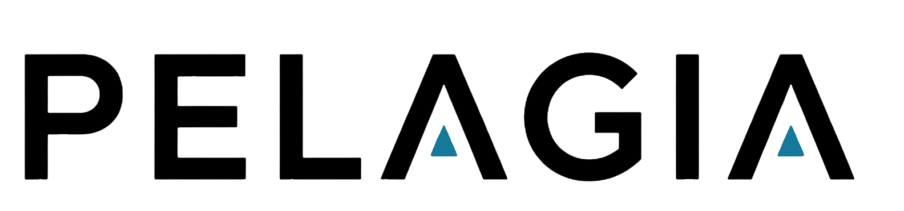
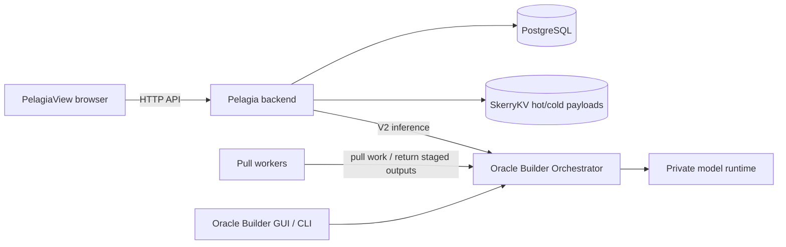

  

# Pelagia

Pelagia is the backend for reproducible scientific-image workflows. It ingests
video, image, and archival interchange data; extracts and refines regions of
interest (ROIs); stores provenance and project-scoped metadata; and runs durable
background jobs through an HTTP API, CLI, and worker system.

The companion [PelagiaView](https://github.com/Icy-Seas-Co-Laboratory/PelagiaView)
browser application provides the operational workspace. Pelagia can call
[Oracle Builder](https://github.com/Icy-Seas-Co-Laboratory/oracle-builder) for
sealed-model inference while remaining a CPU-oriented service.

## Choose a starting point

- **Run the backend:** follow [Getting started](docs/getting-started.md),
  then launch [PelagiaView](https://github.com/Icy-Seas-Co-Laboratory/PelagiaView).
- **Archive image data:** use the independent, standard-library-only
  [`pelagia_interchange`](pelagia_interchange/README.md) package and its
  [`pii`](docs/interchange-usage.md) command.
- **Operate an installation:** see the [documentation index](docs/index.md) and
  [End-User Operations Guide](docs/end-user-support.md).
- **Develop or extend Pelagia:** start with the [architecture](docs/developer-reference.md#system-architecture),
  [configuration](docs/developer-reference.md#configuration), and [developer reference](docs/index.md#developer-reference).

## How the repositories fit together

## Quick start

Install the CPU backend with [uv](https://docs.astral.sh/uv/), configure PostgreSQL and SkerryKV, then follow the detailed [getting-started guide](docs/getting-started.md). For a combined local stack, use `./scripts/pelagia_dev_stack.sh start`.

The optional [PelagiaView](https://github.com/Icy-Seas-Co-Laboratory/PelagiaView) UI runs from its sibling checkout with `npm install` and `npm run dev -- --port 5173`. The [Docker deployment guide](deploy/docker/README.md) covers a combined host.

## Core capabilities

- Video, image, and archival interchange ingestion with source provenance.
- Frame correction, segmentation, ROI crops, masks, measurements, and refinement.
- Project-scoped labels, curation, classification, clustering, and exports.
- Durable jobs, worker heartbeats, event history, and reproducible artifacts.
- CPU-first operation with optional sealed-model inference through Oracle Builder.

For implementation details, see the [developer reference](docs/developer-reference.md). For operations and data formats, use the [documentation index](docs/index.md).
